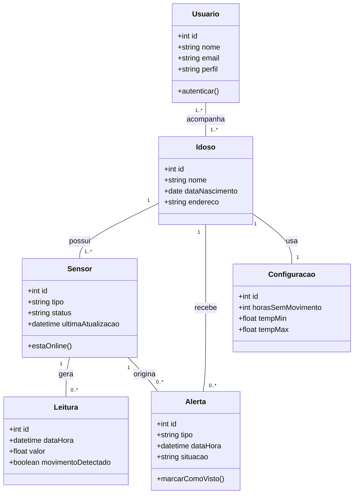
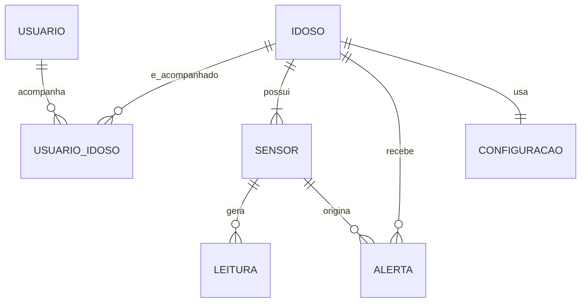

# 🏠 Painel de Monitoramento IoT para Idosos

Painel web que mostra, em tempo real, a **detecção de movimento** e a **temperatura ambiente** da casa de um idoso, com histórico em gráfico, alertas e status de conexão dos sensores.

Projeto extensionista desenvolvido para a disciplina **Tema Integrador III – Projeto de Sistemas**, alinhado ao **ODS 9 – Indústria, Inovação e Infraestrutura**.

🔗 **Demonstração:** https://SEU-USUARIO.github.io/NOME-DO-REPOSITORIO/


---

## 📌 Problema

Muitos idosos passam parte do dia sozinhos. Quedas, imobilidade prolongada ou ambientes muito quentes ou frios podem passar despercebidos, e as soluções comerciais de monitoramento costumam ser caras. Este projeto propõe uma alternativa **simples, acessível e de baixo custo** para famílias, cuidadores e associações de moradores.

## ✨ Funcionalidades

- **Visão Geral:** cards de Movimentação e Temperatura Ambiente em tempo real
- **Histórico:** gráfico de movimento e temperatura por período
- **Alertas:** aviso quando não há movimento por muito tempo ou a temperatura sai da faixa
- **Configurações:** limites de tempo sem movimento e faixa de temperatura
- **Status de conexão:** indica quando um sensor está offline e a última atualização
- Layout responsivo (celular, tablet e computador)

## 🧰 Tecnologias

> Ajuste esta lista para o que você realmente usou.

- HTML5, CSS3 e JavaScript
- Biblioteca de gráficos: [COMPLETAR, ex.: Chart.js]
- Git e GitHub / GitHub Pages
- Dados simulados (versão atual); previsto: ESP32 + sensor PIR + sensor de temperatura

## 🚀 Como executar

```bash
# 1. Clonar o repositório
git clone https://github.com/SEU-USUARIO/NOME-DO-REPOSITORIO.git

# 2. Entrar na pasta
cd NOME-DO-REPOSITORIO

# 3. Abrir o index.html no navegador
#    (ou usar uma extensão como Live Server no VS Code)
```

### Publicar no GitHub Pages

1. No repositório, vá em **Settings → Pages**.
2. Em *Branch*, escolha `main` e a pasta `/ (root)`.
3. Salve e aguarde o link ser gerado.

## 🗂️ Estrutura do projeto

> Ajuste conforme suas pastas.

```
├── index.html
├── css/
│   └── style.css
├── js/
│   └── app.js
├── docs/
│   ├── SRS.md
│   └── preview.png
└── README.md
```

## 📋 Requisitos principais

| ID | Requisito |
|---|---|
| RF01 | Exibir o estado atual de detecção de movimento |
| RF02 | Exibir a temperatura ambiente atual |
| RF03 | Exibir gráfico de histórico por período |
| RF04 | Exibir status de conexão dos sensores |
| RF05 | Gerar alerta de inatividade prolongada |
| RF06 | Gerar alerta de temperatura fora da faixa |
| RF07 | Configurar limites de alerta |
| RNF01 | Interface simples e com bom contraste |
| RNF02 | Funcionar em celular e computador |
| RNF05 | Respeitar a LGPD: apenas movimento e temperatura, sem câmeras ou áudio |

O documento completo de requisitos (SRS) está em [`docs/`](docs/).

## 🧩 Modelagem

### Diagrama de classes



### Modelo Entidade-Relacionamento



## 🧪 Testes

- Testes unitários da lógica de alertas (inatividade e temperatura)
- Testes de integração entre dados simulados, cards e gráfico
- Teste de aceitação com usuários reais (formulário de feedback)

## 🛣️ Próximos passos

- [ ] Integrar sensores reais (ESP32 + PIR + sensor de temperatura) via MQTT ou API
- [ ] Notificações por e-mail ou WhatsApp
- [ ] Login com perfis (familiar, cuidador, administrador) e banco de dados real
- [ ] Relatórios semanais para a família

## 🌍 ODS 9

O projeto contribui com o ODS 9 ao oferecer **inovação acessível** e **infraestrutura digital resiliente** para a comunidade, usando tecnologia de baixo custo.

## 👤 Autor

**SEU NOME** · Curso: [COMPLETAR] · Instituição: [COMPLETAR]
Professor: Hamilcar Silva

## 📄 Licença

Distribuído sob a licença MIT. Veja o arquivo `LICENSE` para mais informações.
